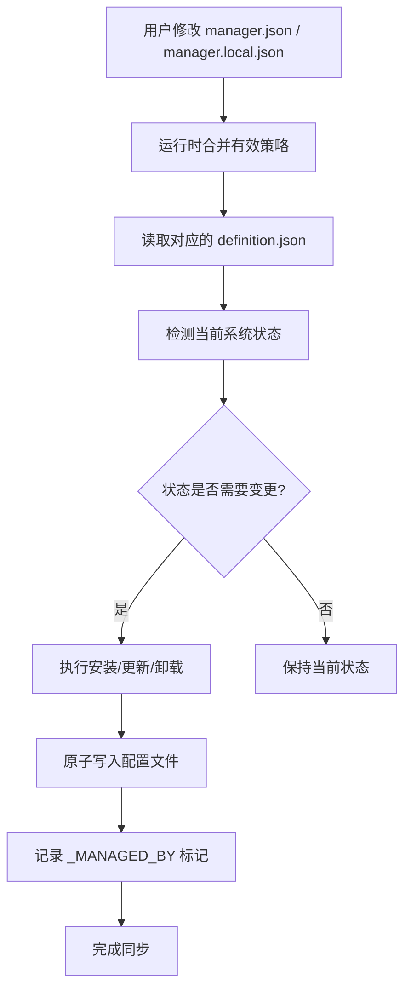

# Agent Manager 架构说明

> 本文档详细说明了 Agent Manager 系统的架构设计和核心组件。

## 目录

1. [系统概览](#系统概览)
2. [核心组件](#核心组件)
3. [数据流设计](#数据流设计)
4. [安全机制](#安全机制)
5. [扩展性设计](#扩展性设计)
6. [部署架构](#部署架构)

---

## 系统概览

Agent Manager 是一个统一的 AI 助手环境管理平台，旨在通过单一入口，对 `Claude Code`、`Gemini CLI`、`Cursor`、`OpenCode`、`Kimi Code CLI` 做生命周期管理，并对 `Codex` 提供受管 MCP / skills / rules 支持。系统采用模块化设计，将策略意愿与具体实现分离，确保配置的精准与安全。

核心设计原则：
- **策略与定义分离**：仓库基线策略（`manager.json`）与机器本地覆盖（`manager.local.json`）在运行时合并，再与技术细节定义（`agents.json`等）配合生效
- **原子化操作**：所有文件写入采用临时文件原子替换模式
- **显式运行时契约**：`dry-run` / `offline` / 锁 / 日志行为必须由 `manage.sh` 统一解释，不能由各同步器各自猜测
- **差异审计**：实时监控物理文件与定义仓库的内容偏离
- **高性能探测**：通过全局状态缓存避免频繁I/O操作

---

## 核心组件

### 1. 策略层 (Policy Layer)
**文件位置**: `config/manager.json` + `config/manager.local.json`

用户决策入口，定义：
- `enabled`: 是否启用该Agent/Tool/Skill/MCP
- `auto_install`: 是否自动安装
- `auto_update`: 是否自动更新
- `preferred_provider`: 首选安装来源
- `manager.json`: 仓库提供的可审计默认值
- `manager.local.json`: 不参与 Git 的本地覆盖层；`make ui` 默认写入这里
- `terminal.enabled`: 控制主流程是否执行终端配置同步；终端配置默认关闭
- `agents` 键使用稳定的机器可读 ID（如 `claude-code`, `cursor`），而不是面向用户的展示名

### 2. 定义层 (Definition Layer)
**文件位置**: `config/*.json`

保存官方指令细节，支持Policy的强制覆盖：
- `agents.json`: Agent安装源和卸载命令
- `tools.json`: 工具安装和设置指令
- `skills.json`: Skill仓库地址和Agent映射
- `mcp.json`: MCP服务器定义和Agent路径映射
- 浏览器自动化相关能力按上游官方分发模型分别托管：`playwright-cli` 与 `agent-browser` 在 `tools.json` 中通过 npm `@latest` 管理。`playwright-cli` 的 runtime setup 由 `playwright-cli install-browser` 完成，并通过 Playwright cache 中的 Chromium payload 重新验证；`agent-browser` 的 readiness 先检查系统 Chrome/Chromium，再检查 Playwright cache 中可复用的 Chromium，只有这些 probe 都失败时才依赖受管 setup；`graphify` 作为 `graphifyy` CLI 由 `uv tool` 管理，并通过 `scripts/setup-graphify.py` 将 skill/rule 安装到各 Agent 目标；`chrome-devtools` 在 `mcp.json` 中通过 `npx -y chrome-devtools-mcp@latest` 维护。
- Agent 定义中的 `display_name` 仅用于展示和日志；跨配置引用统一使用稳定 ID
- `agents.json` 中的 `providers` 只声明 agent-manager 可托管的安装源；`system` 只是运行时探测信号，不是可配置的 provider key
- `preferred_provider` 必须指向 `providers` 中真实存在的键，否则生命周期同步应直接失败
- `skills.json` 中的 skill 仓库支持 `commit` / `ref` 版本约束；技能名来自仓库内 `SKILL.md` frontmatter 的 `name`
- 新增 Agent 时，如需启用某类能力，再声明对应的 MCP / skills / rules target path：`config/mcp.json` 的 `agent_paths`、`config/skills.json` 的 `agents` 映射、`config/rules-targets.list` 的规则与 modules 分发目标
- `Kimi Code CLI` 当前受管路径为 `~/.kimi/mcp.json`、`~/.kimi/skills`、`{{REPO_ROOT}}/.kimi/AGENTS.md`、`{{REPO_ROOT}}/.kimi/modules`；`~/.kimi/config.toml` 不在本轮托管范围

### 3. 同步引擎 (Sync Engines)
**文件位置**: 各agent-*目录下的sync_*.py脚本

负责将策略转换为实际操作：
- `agent-lifecycle/sync_agents.py`: Agent生命周期管理
- `agent-tool/sync_tools.py`: 工具链管理
- `agent-skill/link_skills.py`: Skill链接管理
- `agent-mcp/sync_mcp.py`: MCP配置注入
- `agent-terminal/sync_terminal.py`: 终端配置模板渲染与原子写入
- `agent-rule/scripts/build-agent-rules.py`: Rules 源码片段构建为可分发产物
- `agent-rule/scripts/sync-agent-rules.sh`: Rules文件分发（shell实现）

其中 `agent-lifecycle/sync_agents.py` 需要明确区分三种状态：
- **managed provider**：定义文件中声明且 agent-manager 知道如何 install/uninstall/upgrade 的来源
- **system-only detect**：只是在 PATH 或 App 目录中探测到二进制/应用存在，但不代表 agent-manager 可以安全接管
- **unsupported provider**：运行时探测到了来源，但定义里没有声明；这类情况必须显式报错，不能静默继续

### 4. 审计与验证 (Audit & Verification)
**文件位置**: `src/manage_doctor.py` + `manage.sh` 中的 `doctor_check` 包装器

提供全系统健康检查：
- 配置语法验证
- 一致性审计（文件内容与目录结构漂移检测）
- 环境依赖检查
- 安全风险扫描
- 对尚未物化的 MCP / skills / rules 目标给出提示级告警，而不是与真实漂移混为一谈
- `doctor / status --json` 会输出同一份结构化诊断报告，供 CI 或外部脚本消费
- 主仓库敏感信息扫描默认排除 `secrets/` 私有仓库与忽略缓存，只针对 `agent-manager` 自身受控文件判定泄露风险

---

## 数据流设计

### 配置同步流程


### 凭证管理流程
```mermaid
graph TD
    A[secrets/ 目录检查] --> B{是否存在?}
    B -->|否| C[自动克隆 secrets 仓库]
    B -->|是| D[更新凭证]
    C --> E[读取 secrets/mcp.env]
    D --> E
    E --> F[替换配置中的 ${VAR} 占位符]
    F --> G[生成 Agent 特定配置]
    G --> H[原子写入目标配置文件]
```

### 管理入口运行时契约

`manage.sh` 是唯一的顶层编排入口，负责统一解释全局 flag 和运行时状态：

- **原子锁**：需要写入或同步的命令会先抢占 `/tmp/agent_manager_<user>.lock.d`，并在其中写入持有者 PID；兼容保留 `/tmp/agent_manager_<user>.lock` 作为元数据。`unlock` 会同时清理目录锁和遗留锁文件。
- **按次日志**：每次运行写入独立日志 `/tmp/agent_manager_sync_<user>_<runid>.log`，并更新 `/tmp/agent_manager_sync_<user>.latest` 指针；`logs` 读取 latest，`clean-logs` 清理 latest 与全部历史运行日志。
- **`cleanup`**：清理当前受管目标旁的 `.bak` / `.tmp_*` / restore 临时文件，同时覆盖已退役的 legacy rules 备份路径和 Gemini `tmp` 下的 invalid-json 备份；不清理无受管历史证据的用户文件。
- **安全默认入口**：直接执行 `./manage.sh` 只显示帮助，不会隐式退化到 `all`。
- **`--dry-run`**：只输出计划动作，跳过 secrets 初始化、仓库 clone/pull、依赖安装、构建，以及 `cleanup` / `unlock` / `backups:restore` / `clean-logs` 这类会修改本地状态的维护动作；允许保留只读探测和预览日志。若与 `self-update` 组合，只预览仓库自更新动作。
- **`--offline`**：禁止任何远程拉取、下载和安装。生命周期、tools、skills、MCP 同步器都只能复用本地已存在仓库/配置；如果本地前置资源缺失，应显式报错而不是偷偷联网。
- **命令分层**：`sync` 只做本地配置收敛；`update` 会补齐并刷新非 Agent 安装类资源，并只更新已安装 Agent；`bootstrap` / `all` 才负责缺失 Agent 的安装；`self-update` 只更新 agent-manager 仓库自身。
- **终端配置默认关闭**：只有当有效策略中的 `terminal.enabled` 为 `true` 时，`sync` / `update` / `bootstrap` 才会触发终端配置同步；显式执行 `terminal:sync` 仍可单独运行。
- **诊断双出口**：`doctor / status` 默认输出面向人的文本报告；追加 `--json` 时输出机器可读 JSON，不再需要从文本中抓取 warning 计数。
- **最小 smoke 策略**：`scripts/ci-smoke.sh` 通过 `AGENT_MANAGER_BASE_CONFIG=config/manager.smoke.json` 运行安全预演，避免把默认全量策略带来的未物化提示项混进 CI 基线。

### Rules 构建与分发流程

- `agent-rule/rules/src/` 保存可编辑的共享 core、共享 modules 和 agent adapters。
- `agent-rule/scripts/build-agent-rules.py` 负责把 `src/` 片段生成到 `agent-rule/rules/dist/`。
- 仓库内不再保留第二条平行的规则文本流；`agent-rule/rules/global/*` 已退出仓库 source-of-truth。
- `agent-rule/rules/dist/codex/AGENTS.md`、`dist/claude/CLAUDE.md`、`dist/gemini/GEMINI.md`、`dist/cursor/agent-manager.mdc` 分别对应各 agent 的原生入口格式。
- `config/rules-targets.list` 只声明 `agent-rule/rules/dist/` 下的可分发产物到各 Agent 目标路径的映射。
- manifest 现在同时支持家目录 target 和 `{{REPO_ROOT}}` repo-native target，用一条分发链覆盖全局文件与仓库内原生文件。
- Cursor 的原生入口落到 `{{REPO_ROOT}}/.cursor/rules/agent-manager.mdc`；OpenCode 直接消费仓库根 `AGENTS.md`。
- 规则同步会清理历史遗留的 `~/.<agent>/rules/global.md` 和旧 `rules/modules` 目录，避免新旧入口并存。
- `manage.sh rules:build` / `make rules-build` 用于刷新 `dist/`。
- `manage.sh rules:sync` / `make rules:sync` 用于把 `dist/` 产物同步到目标 Agent 目录与 repo-native 文件位置。
- `config/claude-hooks.json` 定义仓库级 Claude hooks，`agent-rule/scripts/sync-claude-hooks.py` 会把它渲染到 `.claude/settings.json`。
- `config/codex-hooks.json` 定义仓库级 Codex hooks，`agent-rule/scripts/sync-codex-hooks.py` 会把它渲染到 `.codex/hooks.json`。
- `manage.sh claude:hooks:sync` / `make claude-hooks-sync` 用于刷新项目内的 Claude hooks 配置。
- `manage.sh codex:hooks:sync` / `make codex-hooks-sync` 用于刷新项目内的 Codex hooks 配置。
- `scripts/evals/run_rule_effectiveness_eval.py` 读取 `scripts/evals/fixtures/` 中的离线 JSON fixture，校验题目与 run artifact schema，并强制执行 `min_case_count`、`required_agents`、`success / verification` 阈值等 suite requirements；`make eval-rules` 是其推荐入口。
- `make instructions:check` 是修改共享指令、skills exposure 或 managed hooks 前的统一回归硬门禁；它串起 instruction-related project contracts、rules budget、layout、sync、Claude/Codex hook contract tests、eval schema/metric contract tests，以及 baseline 规则评测。

---

## 安全机制

### 1. 原子化写入 (Atomic Write)
所有配置文件写入采用以下步骤：
1. 创建临时文件 (.tmp_* 前缀)
2. 写入数据到临时文件
3. 验证写入成功
4. 原子替换目标文件
5. 设置适当文件权限 (通常是 0o600)

### 2. 凭证保护
- 凭证存储在独立的私有 git 仓库 (secrets/)
- 永不写入主仓库或日志
- 使用环境变量占位符替换
- 支持凭证轮换和审计
- `--offline` 下不会同步 secrets 仓库，只会消费本地已有 secrets 内容
- `make secrets-check`、CI smoke 和 `doctor` 会拦截主仓库中的疑似明文 secrets，防止真实凭证混入 `agent-manager`

### 3. 权限最小化
- 配置文件默认权限为 600 (仅所有者可读写)
- 临时文件同样采用严格权限
- 凭证仓库强烈建议设为私有

---

## 扩展性设计

### 添加新Agent
1. 在 `config/agents.json` 中添加Agent定义
   - 键名必须是稳定 ID（例如 `claude-code`）
   - `display_name` 用于 CLI/UI 展示
   - bin: 可执行文件名称
   - preferred_provider: 首选安装来源
   - providers: 各安装来源的install/uninstall/upgrade命令
2. 在 `config/manager.json` 中添加策略条目
3. 如需MCP支持，在 `config/mcp.json` 的agent_paths中添加映射
4. 如需Skill支持，在 `config/skills.json` 的agents中添加映射
5. 如需Rules支持，在 `config/rules-targets.list` 中声明该 Agent 的 rules 入口与 modules 目标路径

### 添加新MCP服务器
1. 在 `config/mcp.json` 的servers中添加定义
   - command: 执行命令
   - args: 参数列表
   - env: 环境变量映射（支持${VAR}占位符）
   - agents: 限定生效的Agent列表（null表示全部活跃 skill 目标；像 Codex 这类特殊目标只有显式声明时才会纳入）
2. 系统将自动处理不同Agent的格式差异

### 添加新Skill
1. 在 `config/skills.json` 的repositories中添加Git仓库
   - url: 仓库地址
   - commit / ref: 可选版本约束；`commit` 优先级高于 `ref`
   - upgrade_strategy: 可选，显式升级命令使用的版本跟踪策略；当前支持 `latest-tag` 与 `latest-release`
   - skill_paths: 可选，相对仓库根目录的子路径列表；用于只暴露仓库中的指定 skill 目录或 skill 集合目录
   - agents: 限定生效的Agent列表（null表示全部）
2. 仓库会被缓存到 `agent-skill/repositories/<repo-name>/`
3. 只有带 `.agent-manager-owned` 标记的托管缓存目录才会被自动清理
4. 技能目录必须包含 `SKILL.md`，并在 frontmatter 中声明 `name`
5. `auto_update: false` 时系统会复用本地缓存但跳过远程更新；在线模式下分支头仓库使用 `git pull --ff-only`，固定 commit/ref 导致的 detached HEAD 缓存则使用 `git fetch --tags origin`；`--offline` 则禁止下载和远程更新
6. 默认情况下，如果 tool 版本探测或 repo 远端探测返回 `unknown`，系统会记录 warning 并跳过保守回退下载；只有显式传入 `--force-refresh` 时，才会恢复“探测失败后继续升级 / pull / fetch”的旧路径

---

## 部署架构

### 依赖要求
- Python 3.6+
- Git
- 根据所管理的Agent：brew, npm, gh等

### 目录结构
```
agent-manager/
├── config/                    # 配置文件
│   ├── manager.json          # 策略层
│   ├── agents.json           # Agent定义
│   ├── tools.json            # 工具定义
│   ├── skills.json           # Skill定义
│   └── mcp.json              # MCP定义
├── agent-lifecycle/          # Agent生命周期管理
├── agent-tool/               # 工具管理
├── agent-skill/              # Skill管理
│   └── repositories/         # Skill 仓库托管缓存（owner-marked）
├── agent-mcp/                # MCP管理
├── agent-rule/               # 规则管理
│   ├── rules/src/            # 可编辑规则源码
│   ├── rules/dist/           # 生成后的分发产物
│   └── scripts/build-agent-rules.py
├── secrets/                  # 凭证仓库（git子模块或独立仓库）
├── docs/                     # 文档
└── manage.sh                 # 主管理脚本
```

### 工作流程
1. 用户通过修改 `config/manager.json` 或 `config/manager.local.json` 表达意愿
2. 选择入口：`make sync` 做本地配置收敛，`make update` 刷新远端资源，`make bootstrap` 做全量安装、更新与同步；`./manage.sh all` 仅作为兼容别名保留
3. `manage.sh` 先解析 `dry-run` / `offline`，获取原子锁，并建立本次运行专属日志
4. 各同步引擎读取策略和定义，检测当前状态
5. 根据运行模式执行安装、更新或卸载操作
6. 生成Agent特定的配置文件并原子写入
7. 记录管理标记 (_MANAGED_BY = "agent-manager") 以便审计
8. 运行健康检查验证同步结果

---

## 设计决策说明

### 为什么选择JSON作为主要配置格式？
- 广泛支持：所有目标Agent都支持JSON配置
- 人类可读：便于手动检查和编辑
- 机器友好：易于程序解析和生成
- 生态成熟：丰富的工具和库支持

### 为什么保留TOML支持（用于Codex）？
- 某些Agent（如Codex）原生使用TOML
- 为了最大兼容性，系统必须支持目标Agent的原生格式
- 通过特殊处理确保TOML中的特殊字符正确转义

### 为什么 Rules 同时支持复制和符号链接，并默认使用复制？
- 默认复制更稳妥：目标目录可独立审计、备份和回滚，不依赖源仓库持续存在
- 目录型规则需要收敛同步：复制模式可以在分发时删除陈旧文件，避免模块残留
- 符号链接仍然保留给显式选择的高级用法，用于节省空间或实时跟随源内容
- `manage.sh doctor` 会按文件内容和目录结构审计规则目标，而不是只对单文件做 MD5 对比

### 为什么将终端配置改为显式启用？
- `~/.zshrc`、`~/.tmux.conf` 和 iTerm2 动态配置属于高影响用户资产
- 将其纳入默认主流程会放大首次上手的风险和心智负担
- 因此主流程改为仅在 `terminal.enabled=true` 时执行，保持 Agent 管理与终端接管解耦

---

## 未来改进方向

1. **增强插件机制**：支持更灵活的同步引擎插件
2. **图形化界面**：基于Web的配置管理界面
3. **高级审计**：更详细的变更历史和影响分析
4. **多环境支持**：开发/测试/生产环境隔离
5. **性能优化**：进一步减少同步时间和资源占用
