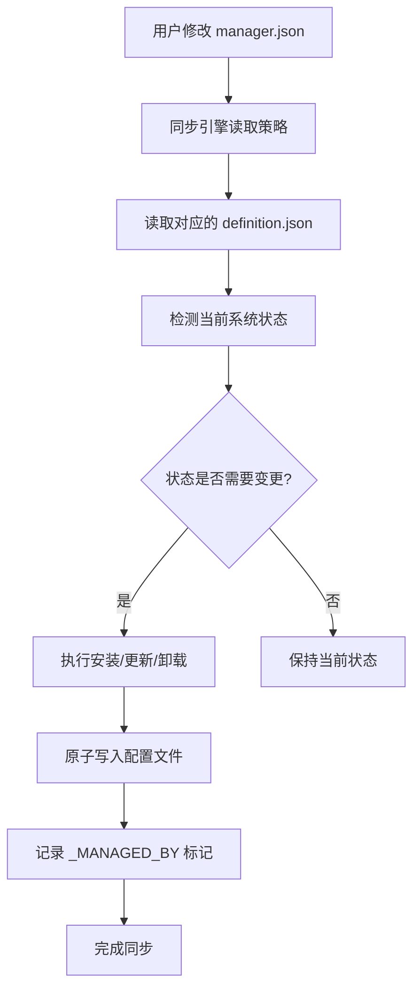

# Agent Manager 架构说明

> 本文档详细说明了 Agent Manager 系统的架构设计和核心组件。

## 目录

1. [系统概览](#系统概览)
2. [核心组件](#核心组件)
3. [数据流设计](#数据流设计)
4. [安全机制](#安全机制)
5. [扩展性设计](#扩展性设计)
6. [部署架构](#部署架构)

---

## 系统概览

Agent Manager 是一个统一的 AI 助手环境管理平台，旨在通过单一入口管理多种 AI 编码助手的完整生命周期。系统采用模块化设计，将策略意愿与具体实现分离，确保配置的精准与安全。

核心设计原则：
- **策略与定义分离**：管理用户意愿（manager.json）与技术细节（agents.json等）分离
- **原子化操作**：所有文件写入采用临时文件原子替换模式
- **差异审计**：实时监控物理文件与定义仓库的内容偏离
- **高性能探测**：通过全局状态缓存避免频繁I/O操作

---

## 核心组件

### 1. 策略层 (Policy Layer)
**文件位置**: `config/manager.json`

用户决策入口，定义：
- `enabled`: 是否启用该Agent/Tool/Skill/MCP
- `auto_install`: 是否自动安装
- `auto_update`: 是否自动更新
- `preferred_provider`: 首选安装来源

### 2. 定义层 (Definition Layer)
**文件位置**: `config/*.json`

保存官方指令细节，支持Policy的强制覆盖：
- `agents.json`: Agent安装源和卸载命令
- `tools.json`: 工具安装和设置指令
- `skills.json`: Skill仓库地址和Agent映射
- `mcp.json`: MCP服务器定义和Agent路径映射

### 3. 同步引擎 (Sync Engines)
**文件位置**: 各agent-*目录下的sync_*.py脚本

负责将策略转换为实际操作：
- `agent-lifecycle/sync_agents.py`: Agent生命周期管理
- `agent-tool/sync_tools.py`: 工具链管理
- `agent-skill/link_skills.py`: Skill链接管理
- `agent-mcp/sync_mcp.py`: MCP配置注入

### 4. 审计与验证 (Audit & Verification)
**文件位置**: `manage.sh` 中的doctor_check函数

提供全系统健康检查：
- 配置语法验证
- 一致性审计（MD5漂移检测）
- 环境依赖检查
- 安全风险扫描

---

## 数据流设计

### 配置同步流程


### 凭证管理流程
```mermaid
graph TD
    A[secrets/ 目录检查] --> B{是否存在?}
    B -->|否| C[自动克隆 secrets 仓库]
    B -->|是| D[更新凭证]
    C --> E[读取 secrets/mcp.env]
    D --> E
    E --> F[替换配置中的 ${VAR} 占位符]
    F --> G[生成 Agent 特定配置]
    G --> H[原子写入目标配置文件]
```

---

## 安全机制

### 1. 原子化写入 (Atomic Write)
所有配置文件写入采用以下步骤：
1. 创建临时文件 (.tmp_* 前缀)
2. 写入数据到临时文件
3. 验证写入成功
4. 原子替换目标文件
5. 设置适当文件权限 (通常是 0o600)

### 2. 凭证保护
- 凭证存储在独立的私有 git 仓库 (secrets/)
- 永不写入主仓库或日志
- 使用环境变量占位符替换
- 支持凭证轮换和审计

### 3. 权限最小化
- 配置文件默认权限为 600 (仅所有者可读写)
- 临时文件同样采用严格权限
- 凭证仓库强烈建议设为私有

---

## 扩展性设计

### 添加新Agent
1. 在 `config/agents.json` 中添加Agent定义
   - bin: 可执行文件名称
   - preferred_provider: 首选安装来源
   - providers: 各安装来源的install/uninstall/upgrade命令
2. 在 `config/manager.json` 中添加策略条目
3. 如需MCP支持，在 `config/mcp.json` 的agent_paths中添加映射
4. 如需Skill支持，在 `config/skills.json` 的agents中添加映射

### 添加新MCP服务器
1. 在 `config/mcp.json` 的servers中添加定义
   - command: 执行命令
   - args: 参数列表
   - env: 环境变量映射（支持${VAR}占位符）
   - agents: 限定生效的Agent列表（null表示全部）
2. 系统将自动处理不同Agent的格式差异

### 添加新Skill
1. 在 `config/skills.json` 的repositories中添加Git仓库
   - url: 仓库地址
   - agents: 限定生效的Agent列表（null表示全部）
2. 系统将自动克隆仓库、安装依赖并创建符号链接

---

## 部署架构

### 依赖要求
- Python 3.6+
- Git
- 根据所管理的Agent：brew, npm, gh等

### 目录结构
```
agent-manager/
├── config/                    # 配置文件
│   ├── manager.json          # 策略层
│   ├── agents.json           # Agent定义
│   ├── tools.json            # 工具定义
│   ├── skills.json           # Skill定义
│   └── mcp.json              # MCP定义
├── agent-lifecycle/          # Agent生命周期管理
├── agent-tool/               # 工具管理
├── agent-skill/              # Skill管理
├── agent-mcp/                # MCP管理
├── agent-rule/               # 规则管理
├── secrets/                  # 凭证仓库（git子模块或独立仓库）
├── docs/                     # 文档
└── manage.sh                 # 主管理脚本
```

### 工作流程
1. 用户通过修改 `config/manager.json` 表达意愿
2. 运行 `make all` 或 `./manage.sh all` 启动同步
3. 各同步引擎读取策略和定义，检测当前状态
4. 根据需要执行安装、更新或卸载操作
5. 生成Agent特定的配置文件并原子写入
6. 记录管理标记 (_MANAGED_BY = "agent-manager") 以便审计
7. 运行健康检查验证同步结果

---

## 设计决策说明

### 为什么选择JSON作为主要配置格式？
- 广泛支持：所有目标Agent都支持JSON配置
- 人类可读：便于手动检查和编辑
- 机器友好：易于程序解析和生成
- 生态成熟：丰富的工具和库支持

### 为什么保留TOML支持（用于Codex）？
- 某些Agent（如Codex）原生使用TOML
- 为了最大兼容性，系统必须支持目标Agent的原生格式
- 通过特殊处理确保TOML中的特殊字符正确转义

### 为什么使用符号链接而非复制文件？
- 减少磁盘空间占用
- 确保始终使用最新版本
- 简化更新过程（只需更新源仓库）
- 保持与原始仓库的一致性

---

## 未来改进方向

1. **增强插件机制**：支持更灵活的同步引擎插件
2. **图形化界面**：基于Web的配置管理界面
3. **高级审计**：更详细的变更历史和影响分析
4. **多环境支持**：开发/测试/生产环境隔离
5. **性能优化**：进一步减少同步时间和资源占用