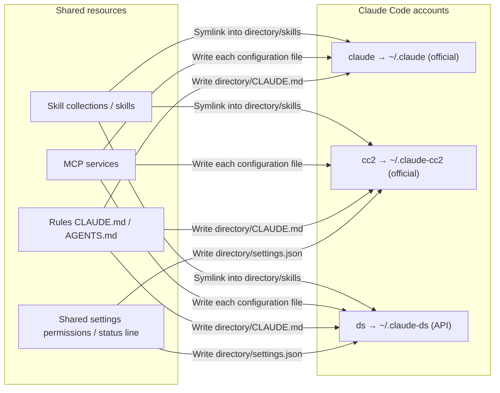

# Concurrent Accounts: Redesign and Implementation Plan

> Current scope (2026-10-11): [Extensions only](EXTENSIONS-ONLY.md) supersedes every account-management, authentication, launch-command, account-credential, and assistant-lifecycle requirement below. Earlier implementation and acceptance entries are historical; they do not authorize these operations or establish acceptance of the new scope.


Current scope amendment (2026-10-10): [Lightweight desktop goal](goal-lightweight.md)
retires monitoring and background residency. Accounts, launch commands, resource
assignment, Sources, and dependency programs remain. Earlier quota, tray, and
session requirements below are historical acceptance records, not new obligations.

Status: **Design confirmed and implemented (2026-09-28)**. P0–P7 are complete (2026-09-29: an account was created through the UI of a DMG built from the current code and read back). P5 quota writes still lack testing with an official subscription session; see Implementation Record below. Conflicting material in [GUI Redesign](GUI-REDESIGN.md) (main-configuration switching, saved connections, overview, etc.) was retired under Appendix A and is no longer a new requirement.

## 1. Positioning

**Agent Manager lets multiple Claude Code / Codex accounts run simultaneously: each account has its own configuration directory and controlled launch command. Skills, rules, and credential-free MCP entries can be shared. Credential references and authentication settings belong to one account.**

The 2026-10-10 account-isolation decision was part of this historical design. [Extension Target Isolation](ACCOUNT-ISOLATION.md) now documents the retained path and credential protections for extension operations.

- Use case: work in parallel with one account per terminal; when an account is nearly out of quota, continue in another account's terminal.
- Deployment model: a single-user local desktop application plus a CLI using the same Rust library. The assistant CLI owns official login and logout. The tool reads local identity metadata and resolves explicitly selected account-owned API/MCP secrets; it does not store their values in SQLite or backups.
- Switching is no longer the central workflow: accounts have no current/alternative distinction; all are peers and can be used concurrently.

### Goals

1. See every account for each assistant on one screen: launch command, official or API, login status, and quota.
2. Add an account by answering only Official or API? and What name? Directory, launch command, skills, MCP, rules, and shared settings are prepared automatically.
3. Install skills, MCP, and rules once and assign them to all accounts by default; individual accounts can disable an item.
4. In the default window (1000×650), each page's main list appears on the first screen, with no dragging needed to see actions and results.

### Non-goals

- Switching third-party connections in the main configuration (use tools such as cc-switch or create an API account).
- Owning official login credentials: login and logout use the assistant CLI in an explicit account context. Local authentication files are read to detect mixed modes and display identity metadata; their credential values are not stored in the database or backups. Decoded JWT labels do not validate signatures or remote identity.
- Installing, upgrading, or uninstalling assistant software.
- Saving a separate effective configuration for Agent Manager: actual files remain the sole source of truth.

## 2. Conceptual Model



**Account = a configuration directory + an authentication mode + owned credential references + an endpoint + a controlled launch command.** The generated command validates its registration binding and sets `CLAUDE_CONFIG_DIR` / `CODEX_HOME` explicitly. Main Claude's official login metadata is at `HOME/.claude.json`; an independent Claude account's is inside its directory.

- **Main account:** `~/.claude` / `~/.codex`, addressed explicitly by the controlled command. Official login only (preserving the existing main-configuration policy); displayed read-only, with no switching action.
- **Official account:** a separate directory; use its generated login command once, then each account uses its own subscription.
- **API account:** a separate directory holding endpoint, secret reference, and model; official login is not allowed there (preserving one credential type per directory).
- **Shared resources:** credential-free skills, MCP, rules, and shared settings. Assignment means which accounts have a resource; all accounts are the default. Credential-bearing MCP entries require separate account configuration and ownership.

Evidence, all from local testing or source on 2026-09-28:

| Fact | Evidence |
| --- | --- |
| Claude official login is isolated by directory | Observed: Claude Code 2.1.284 names its keychain entry `Claude Code-credentials-<first 8 hex digits of the configuration directory sha256>` when `CLAUDE_CONFIG_DIR` is set |
| Claude user rules and skills follow the configuration directory | Observed: in the same version, User-level `CLAUDE.md`, `skills/`, `rules/`, `agents/`, and `commands/` all use the configuration directory as their root |
| Codex login is isolated by directory | Observed in an older verification record, not retested: the [Work Plan](goal-rust-gui.md) records `rust-v0.156.0` keyring separation by `CODEX_HOME` digest |
| Quota can be read per directory | Observed: `agent_usage.rs` reads status-line output files and `.claude.json` caches per configuration directory; Codex reads `<CODEX_HOME>/sessions` |

## 2.1 Management Model: Objects, Unified States, and Complete Workflows (2026-09-30, User-confirmed)

The application follows one model that determines its pages and buttons. Each responsibility has one owner.

**Objects and relationships.** Accounts (configuration directory + launch command) define where configuration takes effect. Skills, MCP, rules, commands, and account settings define what takes effect. Sources (git repositories, local directories, rule files) define where content comes from and which version is used. Each relationship has one responsible page: source → resource (provision, including version) belongs to **Sources**; resource → account (assignment) belongs to **resource pages**; accounts themselves belong to **Accounts**. MCP and account settings have no source layer: their content is the actual value in account configuration files. Accounts of the same assistant type share skills, MCP, and rules by default (confirmed).

**Sources are optional (confirmed 2026-10-08).** Every external repository and content source can be left unconfigured without blocking startup, account management, or reading/writing actual local configuration. The author's public repositories are recommendations only; they are not automatically added, downloaded, or counted as pending. Users enter secrets directly or select their own external file / private repository. The author's private secrets repository is neither recommended nor required.

**Unified states.** Existing domain terms (skills `linked / missing-link / dead-link / drifted / extra-link / disabled`, MCP `enabled / disabled / invalid`, rules `same / differs / missing`, sources `current / behind`) map to the following states, each with one action (mapping in `app/src/lib/inbox.ts`):

| Unified state | Meaning | Only action | Responsible page |
| --- | --- | --- | --- |
| Effective | Actual files match expectations | — | — |
| Disabled | Intentionally disabled by the user | Enable | Resource page |
| Broken | Dead link, unrecognized entry, missing command, unresolved variable, or source read failure | Repair or remove | Resource / Sources page |
| Drifted | Externally changed and inconsistent with source or expectation (occupied entry point, edited rules with a changed source, different terminal-file representations, duplicate Codex names) | Review differences and decide | Resource / Sources page |
| Missing | Used by accounts of the same type but absent from this account | Fill | Resource page |
| Update available | Source has new content, or content has been fetched but accounts have not switched | Update (preview git first) | Sources page; switch directly if already fetched |
| Unmanaged | Present in an account but not from any source | Adopt or leave unmanaged | Unmanaged section of Sources |

**Complete workflow.** Read actual files → compute state → pending items (one computation for the unified list and navigation badges) → the only applicable action → write pipeline (preview changes only → confirm → lock and compare before writing → read back → record, with undo) → after readback, state returns to Effective and the pending item disappears. Direct actions (fill, repair, switch to an already fetched version, add newly discovered skills) are available in Inbox and use the same actions as resource pages. Actions requiring differences or choices navigate to the responsible page and locate the item.

Inbox aggregates status and entry points without duplicating page details (adjusted after user feedback on 2026-09-30). Categories are collapsible and collapsed by default; headings show counts and summaries. Items with the same cause and source merge into one row (for example, Unused skills in wecom-cli · 9 items; expand to see the list and go to that source in Skills to act). Users may Ignore a row or an entire category. Ignored items do not count in navigation badges or Pending only filters and appear under Ignored at the bottom, where they can be restored. Ignore records use the item plus its explanation at that time; changed state (for example, more skills in the source) prompts again. Ignoring stores only local UI preferences and writes no configuration.

**Navigation follows the model.**

| Navigation | Owns | Does not own |
| --- | --- | --- |
| Inbox | Aggregates all non-Effective items, grouped with one action button per item | Independent judgments; uses unified states only |
| Accounts | Account creation, login, launch commands, account settings, discovery of unregistered assistants | Resource assignment (read-only summary linking to its owner) |
| Skills · MCP · Rules · Commands | Assignment: enable/disable, edit, delete, fill; unified state labels and Pending only | Adding/updating/switching/removing sources (labels such as Update available link to Sources) |
| Sources | Add, recommend, edit tracking, check/update (preview git first), switch versions, share, disable, remove; adopt unmanaged resources (keep one source when recognized, register external directories as local-directory sources, clean residual links); import from share links | Which accounts receive a resource |
| Programs | CLI programs required by skills and MCP: dependents, location, version; delegated upgrades/rollback, tool-managed installation, version switching, deletion, adoption, MCP entry version pinning/upgrades. Every action has an equivalent copyable command ([Program Lifecycle](PROGRAM-LIFECYCLE.md)) | Assistants themselves (version detection only on Accounts) |
| Settings | Secrets, operation records and undo, diagnostics, application updates | Business resources |

## 3. Features and UI

Replace the sidebar and shortcut legend with a top bar. Page headers contain only a title, with no description paragraph. The top bar has no horizontal scrollbar: the application name appears only in the window title bar. When primary entries do not fit, move entries from the end into More (show total pending count; if the current page is inside, show its name on the button). Search becomes an icon in narrow windows.

```
[Inbox] [Accounts] [Skills] [MCP] [Rules] [Commands] [Sources] [Programs]        [Usage] ⚙
```

### 3.1 Accounts (Default Page)

```
Claude Code | Codex                                               [+ Add account]
Personal Max  claude  Official · Logged in  5h ███████░ 82%  Week ██░ 31%  [Copy] ⋯
Work Pro      cc2     Official · Logged in  5h ██░░░░░ 20%  Week █░░ 12%   [Copy] ⋯
Team          cc3     Official · Not logged in                           [Log in] ⋯
DeepSeek      ds      API · deepseek-v4                                    [Copy] ⋯
```

- One account per row with one primary button: Copy the launch command when usable; Log in when not logged in (copies the official login command for that directory).
- Quota bars cover 5-hour and weekly windows. Hide them after reset; gray out records older than 24 hours (retaining the Quota Sources criteria).
- `⋯` menu: edit, open directory in Finder, copy directory path, remove.
- Clicking the row name opens a right drawer: name, launch command, directory (read-only); API accounts also show endpoint, secret reference, and model. Existing skills / MCP / rules appear below and can be disabled individually.
- **Add account** drawer: type (official / API), name, launch-command name (derived from the name by default); API accounts can select existing presets such as DeepSeek and MiniMax. Saving creates the directory → writes shared settings and API parameters → distributes shared resources → writes the launch command; official accounts then prompt Log in.
- Only three actionable status labels:
  - Not logged in → Log in.
  - Launch command not effective (alias absent from the shell) → Write.
  - Directory changed externally → Adopt directory content.
  Other details (system-level overrides, credential overrides) appear only in the drawer.

### 3.2 Skills

```
[Collection ▾] [Account ▾] [Search] [Pending only]                         [Fill All]
agent-skills   24 skills · Update available                                  [Update] ⋯
  change-discipline         All accounts                                              ⋯
  verification              All accounts except ds                                    ⋯
team-skills    6 skills                                                       [Update] ⋯
```

- Two levels: collection (git repository) → skills. Each skill shows its assigned accounts, defaulting to All accounts.
- Assignments use content-addressed snapshots and symlinks (existing implementation); new accounts automatically receive skills assigned to All accounts.
- Skills in account directories that this tool does not manage (external links, real directories) appear in Unmanaged on Sources for adoption. Skills provides only a navigation entry there.
- Source addition, updates, version switching, and removal belong to Sources (2.1). Update available, Not downloaded, and Invalid tracking labels in Skills navigate there; Skills does not update sources directly.
- See [Skill Sources: Versioning and Adoption](SKILL-VERSIONING.md) for source version tracking (release / main branch), updates and rollback, adoption, and redundancy cleanup.

#### Source Lifecycle (2026-09-29, User-confirmed)

| Stage | Behavior |
| --- | --- |
| First installation | Writes no rules, MCP, skills, or launch commands; page queries do not invoke official commands that write configuration directories. Sources recommends agent-skills and registers it only after confirmation (Enable… also downloads it and links it to all accounts, skipping existing same-name content; Add… only registers it). Rules are not written here. Dismissing the recommendation prevents future recommendations. Sources are optional: the Getting started flow on Accounts allows Skip for this step, and existing skills/MCP/rules continue to be managed from actual files without a source. |
| No longer wanted | Collection rows always offer Remove source (also available for rules from collections in the rule library). Confirmation lists impacts: remove skill links without touching user-owned same-name directories; preserve rule-file content and stop following the source; leave written launch commands intact. Git collections remove downloaded repositories and unused version snapshots by default. Disabled or removed recommended sources are not recommended again. Disabling/removing affects only links pointing to this collection's content. |
| Customize a source | Enabled skills are read-only snapshots and cannot be edited in place. Make my own version… copies the currently used version into a user directory (default `~/my-skills`), registers a local user collection and provenance, and switches selected accounts to it. Original source updates leave user files alone and show only Original has updates. Rules written into accounts are user files; after edits, source updates only notify, and overwrite requires reviewing differences and confirming, with a backup saved first. |

### 3.3 MCP

- One service per row: name, command or URL, All accounts / N accounts; `⋯` offers edit, copy, and delete.
- Editing writes directly to each account's own configuration (Claude `<directory>/.claude.json`, Codex `<directory>/config.toml`), with comparison before writing.
- A same-name service with different contents across accounts shows Different across accounts; the drawer displays each account separately.

### 3.4 Rules

- One rule-file source per row: a local template, a directly specified file/directory, or a rules location within a skill collection (default `rules/`, configurable to a subdirectory or specific file). Show assigned accounts.
- Distribution writes `<directory>/CLAUDE.md` / `<directory>/AGENTS.md`. Save a backup first if the target contains unrecognized content (preserving existing behavior).

### 3.5 Other Entries

- **Shared settings:** Settings lets users choose which settings to synchronize from the main account to other accounts (currently permissions, status line, rules, MCP).
- **Usage:** retain account-specific token statistics as a secondary entry on the right of the top bar.
- **Scan existing local content:** unregistered assistants appear at the bottom of Accounts; external skill directories, unexpected links, and residual links appear in Unmanaged on Sources. Hide these sections when nothing is actionable.
- **Tray:** one row per account with its tightest quota window and reset countdown; left click opens a panel with every account's quota bars and a Copy button for its launch command (2026-10-09). Display and copy only: no switching.

### 3.6 Layout Rules (Acceptance Criteria)

- List rows are about 48–56px high, one item per row; statuses use labels rather than sentences.
- Each row exposes one primary action; the rest go into `⋯`. All editing uses right drawers.
- List pages have no explanatory text longer than one line; explanations belong in `ⓘ` tips or empty states.
- No nested cards: a list is one block, grouped by heading rows.

## 4. Data and Write Rules

Retain [GUI Redesign · Data Model](GUI-REDESIGN.md#data-model-the-actual-configuration-is-authoritative): actual files are the sole source of truth; reread and compare before writing; do not overwrite external changes; queries perform zero writes. Only these rules are added or changed:

| Item | Rule |
| --- | --- |
| Account registration | Store only account id, display name, assistant, directory, launch-command name, and type. Actual directory files determine API parameters; database copies are used only to determine ownership |
| Definition differs from actual configuration | No longer a concept. External changes show only Directory changed externally, with one action: Adopt directory content |
| Shared resource assignment | Skills and rules retain their existing assignment behavior. MCP Fill and Copy accept only credential-free entries with understood fields. Credentials, credential references, authentication helpers, and ambiguous extras block copying; configure them separately for the target account. Fill does not re-enable disabled services or overwrite existing rule files |
| Main account | Show connection type read-only; do not write third-party connections or provide Switch back to official |
| Account removal | Remove launch command and registration; preserve directory by default (including sessions and login), deleting it only when selected by the user |

## 5. Implementation Approach

The backend already largely models multiple accounts (instance = directory + launch command; skills/MCP/rules distribute to instances). The main work is rewriting the frontend and removing the entire main-configuration switching workflow.

| Module | Treatment | Notes |
| --- | --- | --- |
| `native_profiles` (instances) | Reuse | Account CRUD and shared settings; `seed`, `apply-definition`, `shared-apply` already exist |
| `native_aliases` | Reuse | Write launch commands in the managed `~/.zshrc` block; synchronize an existing `~/.zprofile` block without creating one |
| `native_skills` / `native_mcp` / `native_rules` | Reuse with small changes | Add All accounts by default and fill assignments for new accounts |
| `agent_usage` + `assets/statusline.sh` | Reuse and wire up | Install the status-line script for each account through shared settings, enabling real-time quota (decision 1) |
| `native_auth` | Reuse | Read-only login status and official login command generation |
| `native_discover` | Reuse | Initial import |
| `native_usage` | Reuse | Usage page |
| `native_agent_settings` (4319 lines), connection library, `agents:configure` switching | Delete | Main-configuration switching, saved connections, runtime settings forms; retire UI first, then clean backend in a separate commit |
| `native_hooks` | Remove entirely (2026-09-29, user decision) | UI, bridge, and engine domain removed; hooks in account files preserved |
| Frontend `AgentsPage`, `ConnectionWorkbench`, `ConnectionFormDialog`, `ProfileCards`, `ProfileFormDialog`, overview, operation records, command-palette switching items | Delete | Replaced by new pages |
| New frontend | Add | `AppShell` (top bar), `AccountsPage`, `AccountDrawer`, list templates and drawers for `SkillsPage`, `McpPage`, `RulesPage` |

The original aggregation proposal below remains a design goal rather than an implemented interface. Current account reads combine `profiles:status`, `agents:auth-status`, and quota reads. The controlled command interface is `accounts:command`; account creation uses `profiles:create` so definition, credential, and file changes share one checked transaction. See [account context](subsystems/account-context.md) for the current contract.

## 6. Alternatives

| Approach | Benefits | Cost | Decision |
| --- | --- | --- | --- |
| **This plan:** retain backend, narrow scope, rewrite frontend | Multiple accounts, symlinked skills, per-account distribution, existing tests | Frontend rewrite and old UI test rewrites | Adopt |
| Fork cc-switch and add multiple accounts | Mature UI, provider switching, community updates | Observed: one fixed directory per assistant (`get_app_skills_dir(app)`), hard-coded MCP assignment fields such as `apps.claude`; multiple accounts require core/schema changes, and upstream's 14–58 weekly commits cause ongoing merge conflicts | Reject |
| Keep adjusting the existing UI | Smallest change | Tried for a week: switching-centered information architecture itself makes pages difficult to understand | Reject |
| CLI + tray only | Least work | Loses the core value of one screen showing all account quotas and shared resource assignments | Reject |

cc-switch may coexist with this tool for provider switching only. Do not enable MCP and skill features in both, or they will overwrite the same files.

## 7. Risks and Verification Points

| Risk | Evidence level | Treatment |
| --- | --- | --- |
| Stale quota: `.claude.json` cache refreshes only when Claude actively queries it, misleading account selection | Observed (Quota Sources document) | Install the status-line script for each account through shared settings (decision 1); otherwise label quota Cache · N minutes ago |
| Pages become long prose again | Inferred from this round's lessons | Make 3.6 layout rules acceptance criteria; deliver a 1000×650 first-screen screenshot and content height for every page |
| Conflict with existing user aliases (such as `alias claude='…'`) | Observed: a local `claude` alias has arguments | Read the main account's existing alias without rewriting it; reject and explain new account command-name conflicts |
| Existing instance migration | Inferred | Display existing instances as accounts without changing files; preserve old saved connections read-only in Settings · Legacy data until users delete them |
| Codex login isolation | Observed (2026-09-29, codex-cli 0.159.0): `login status` in isolated `CODEX_HOME` reported not logged in; main-account credentials use file storage at `~/.codex/auth.json` | Verify main-account login survives actual login in an isolated directory; requires user login and has not been tested |
| Many frontend tests depend on old text | Observed | Delete old-page tests with those pages; migrate data safety, pre-write comparison, and scope isolation assertions into new pages or Rust tests without reducing coverage |

## 8. Phased Plan

Commit and independently verify each phase; separate code cleanup from behavior changes.

| Phase | Delivery | Completion criteria |
| --- | --- | --- |
| P0 | After confirming this document, rewrite positioning/UI sections in `docs/GUI-REDESIGN.md` and current goals in `AGENTS.md`; list removals | Working links/commands; no old requirements conflicting with this plan |
| P1 | Top-bar shell + Accounts page (read-only list: launch command, type, login, quota, Copy / Log in) | With mocks and isolated HOME, all accounts visible on the first 1000×650 screen; `pnpm test:unit run` and `pnpm build` pass |
| P2 | Add/edit/remove account drawers (official, API) | Actually create two accounts in isolated HOME and read back directory, alias, shared settings, and skill symlinks individually; reject external changes |
| P3 | Skills page rewrite + All accounts by default | New skills link to all accounts automatically; disabling on one account affects only that account; all `cargo test` checks pass |
| P4 | MCP and Rules page rewrites | Write and read back the same service in each account configuration; write rules to `<directory>/CLAUDE.md` and have actual Claude read them |
| P5 | Real-time quota: distribute status-line script through shared settings to each account | Actual sessions update quota files; Accounts shows Real-time |
| P6 | Delete old pages/components/tests; remove main-configuration switching and connection library from backend | Reference inventory is empty; complete `cargo test` (engine-rs, Tauri), Vitest, and build pass |
| P7 | Account-list tray; update README/screenshots; package verification | DMG launches in isolated HOME and completes account creation |

## 9. Confirmed Decisions (2026-09-28, User-confirmed)

| # | Question | Decision |
| --- | --- | --- |
| 1 | Install quota status-line scripts for each account? | Install for every account through shared settings |
| 2 | Default assignment for new skills / MCP / rules | All accounts |
| 3 | Appendix A removal list | Remove every unneeded feature |
| 4 | What belongs in main accounts? | Official login only; create separate accounts for all API access |

## Appendix A: Removal List

UI entries (replaced in P1–P4, code deleted in P6):

- Assistants page: default environment card; View actual configuration files; account/login, runtime settings, launch-command subpages; mixed-use notices; current actual configuration (unsaved); official-account card and Switch back to official; third-party connection library and Create independent environment; instance Definition differs from actual comparison and two-way overwrite buttons; Update shared settings button (moved to Settings).
- Overview, operation records page (audit logs continue to be written to the database; Settings retains Clear), update center.
- Account switching and connection items in the command palette (`⌘K` remains for page/account search).
- Entire Hooks feature (user decision on 2026-09-29 invalidates the original fold-into-shared-settings plan): page, editor, hooks in new accounts, shared-settings hook synchronization, and `hooks:*` engine commands were all deleted. Existing hooks in account files remain intact; since 2026-10-10, executable hooks block controlled startup because their identity effects cannot be validated. `hooks.*` in old backups are skipped during import.

Backend (P6, separate commit):

- Connection switching in `agents:configure`, `--use-default`, saved-connection persistence/import, and portions of `native_agent_settings` serving only those features.
- Retain `agents:auth-status`, quota reads, and all write protections for instances / aliases / skills / MCP / rules / usage / discovery / secrets.

## Implementation Record

| Phase | Commit | Verification |
| --- | --- | --- |
| P0 documentation | `0ff01a6` | Link checks |
| P1 top bar and Accounts | `2375b85` | Frontend tests, 1000×650 screenshot |
| P2 account CRUD | `69f701d`, `827eb49` | Actual creation/edit/removal and readback in isolated HOME |
| P3 skills | `3553c0c`, `49cbb5f` | Fill and exception readback in isolated HOME |
| P4 MCP and rules | `974b3bd`, `8e66fcb`, `4f3a796` | Copy/fill readback in isolated HOME; fixed removed accounts remaining MCP targets |
| P5 real-time quota | `2246430` | Wrote/synchronized status line in isolated HOME; simulated one status-line invocation and read real-time quota. On 2026-09-29, an actual interactive Claude session rendered this tool's status line, but API Key sessions had no `rate_limits`; quota file writes still lack subscription-account testing |
| P6 cleanup | `1237065`, `1082269`, `2283a9b` | Complete engine/bridge/frontend tests; retired commands return `UNKNOWN_VERB`; `2283a9b` removed residual main-configuration connection recognition |
| P7 tray and README | `1237065` and this documentation commit | Tray unit tests; package verification in [Platform Status](GUI-PLATFORM-STATUS.md) |
| P2 / P4 / P7 additional verification | `2e70d14` | Created an API account through the DMG UI in isolated HOME and read back each file; actual Claude read copied rules through the new launch command. See the [Work Plan](goal-rust-gui.md), Delivery Receipt (2026-09-29, Multi-account Version) |
