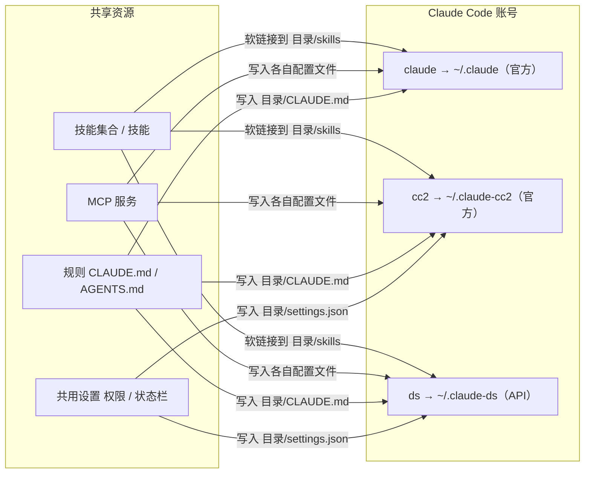

# 多账号并行：重新设计与实施规划

状态：**方案已确认并实施（2026-09-28）**，P0–P7 已完成（2026-09-29 用当前代码的 DMG 在界面新建账号并回读）；P5 的额度写入仍缺官方订阅会话实测，见文末「实施记录」。[GUI 重设计](GUI-REDESIGN.md) 中与本文冲突的内容（主配置切换、接入备选、总览等）已按附录 A 退役，不再作为新要求。

## 1. 定位

**Agent Manager 让同一台 Mac 上的多个 Claude Code / Codex 账号同时使用：每个账号一个独立配置目录、一条启动命令，一套技能、MCP 与规则以软链接或受管条目分发给所有账号。**

- 使用场景：几个终端各开一个账号并行干活；某个账号额度快用完，换另一个终端里的账号继续。
- 部署模型：单用户、本机桌面应用 + 同一 Rust 库的 CLI；只读写本机文件，不联网改配置，不读写凭据。
- 不再以「切换」为主线：账号之间没有「当前」与「备选」，都是并列、同时可用的。

### 目标

1. 一屏看清每个助手的全部账号：启动命令、官方还是 API、登录状态、额度。
2. 新增一个账号只需回答「官方还是 API」「叫什么」，其余（目录、启动命令、技能、MCP、规则、共用设置）自动就位。
3. 技能、MCP、规则装一次，默认分配给全部账号；个别账号可以关掉某项。
4. 默认窗口（1000×650）里每页首屏就是主列表，操作与结果不需要拖动。

### 非目标

- 在主配置里切换第三方接入（交给 cc-switch 等工具或新建 API 账号）。
- 读写登录凭据：登录只通过助手自己的 `/login` / `codex login`。为认出是哪个账号，只读取身份信息：Claude 的 `.claude.json` 登录记录，Codex `auth.json` 里 `id_token` 的邮箱与套餐；令牌取值一律不读、不存。
- 助手软件的安装、升级、卸载。
- 为 Agent Manager 另存一份生效配置：实际文件仍是唯一事实源。

## 2. 概念模型



**账号 = 一个配置目录 + 一条启动命令。** 启动命令以 `CLAUDE_CONFIG_DIR` / `CODEX_HOME` 指向该目录，助手的登录、设置、会话、技能、规则都在里面，所以多个账号可以同时运行。

- **主账号**：`~/.claude` / `~/.codex`，启动命令就是 `claude` / `codex`。只放官方登录（沿用现行「主配置只放官方账号」）；只读展示，不提供切换。
- **官方账号**：独立目录，在该目录里 `/login` 一次，之后各用各的订阅。
- **API 账号**：独立目录，写入地址、密钥引用、模型；不能在里面登录官方账号（沿用「一个目录只放一种凭据」）。
- **共享资源**：技能、MCP、规则、共用设置。它们的「分配」就是「哪些账号有它」，默认全部账号。

依据（均为本机实测或源码，2026-09-28）：

| 事实 | 依据 |
| --- | --- |
| Claude 官方登录按目录隔离 | 已观察：Claude Code 2.1.284 钥匙串条目名为 `Claude Code-credentials-<配置目录 sha256 前 8 位>`（设了 `CLAUDE_CONFIG_DIR` 时） |
| Claude 用户规则与技能跟随配置目录 | 已观察：同一版本里 User 级 `CLAUDE.md` 与 `skills/`、`rules/`、`agents/`、`commands/` 都以配置目录为根 |
| Codex 登录按目录隔离 | 已观察（旧验收记录，未重测）：[任务书](goal-rust-gui.md) 记录 `rust-v0.156.0` keyring 按 `CODEX_HOME` 摘要区分 |
| 额度可按目录读取 | 已观察：`agent_usage.rs` 按配置目录读状态栏落盘文件与 `.claude.json` 缓存；Codex 读 `<CODEX_HOME>/sessions` |

## 2.1 管理体系：对象、统一状态与闭环（2026-09-30，用户确认）

整个应用按同一个模型组织，页面和按钮都由它推出，同一件事只有一个负责的地方。

**对象与关系。** 账号（配置目录 + 启动命令）是「在哪生效」；技能、MCP、规则、命令、账号设置是「什么在生效」；来源（git 仓库、本机目录、规则文件）是「内容从哪来、用哪个版本」。三种关系各有唯一负责的页面：来源 → 资源（提供，带版本）在**来源页**；资源 → 账号（分配）在**资源页**；账号本身在**账号页**。MCP 与账号设置没有来源这一层，内容就是账号配置文件里的实际值。同类账号默认共享技能、MCP、规则（已确认）。

**统一状态。** 各领域原有的状态词（技能 `linked / missing-link / dead-link / drifted / extra-link / disabled`，MCP `enabled / disabled / invalid`，规则 `same / differs / missing`，来源 `current / behind`）统一映射成下面几种，每种只对应一个处理动作（映射在 `app/src/lib/inbox.ts`）：

| 统一状态 | 含义 | 唯一处理动作 | 在哪处理 |
| --- | --- | --- | --- |
| 生效 | 实际文件与预期一致 | — | — |
| 已停用 | 用户主动停用 | 启用 | 资源页 |
| 损坏 | 断链、条目无法识别、找不到命令、变量没取值、来源读取失败 | 修复或移除 | 资源页 / 来源页 |
| 已偏离 | 被外部改过，与来源或预期不一致（入口被占用、规则改过且来源也更新、两个终端文件写法不同、Codex 重名） | 看差异后决定 | 资源页 / 来源页 |
| 缺失 | 同类账号在用、这个账号还没有 | 补齐 | 资源页 |
| 有新版本 | 来源有新内容，或已取回、账号还没换过去 | 更新（git 先预览） | 来源页；已取回的直接换 |
| 未纳管 | 在账号里、但不来自任何来源 | 纳入，或留着不管 | 来源页「未纳管」 |

**闭环。** 读取实际文件 → 算出状态 → 待处理（统一列表 + 导航角标，同一份计算）→ 唯一的处理动作 → 写入管线（预览只显示改动 → 确认 → 加锁、写前比对 → 回读 → 记录，可撤回）→ 回读后状态回到「生效」，这一条从待处理里消失。能直接做的（补齐、修复、换到已取回的新版本、添加新发现的技能）在待处理页做，和资源页上是同一个动作；要看差异或做选择的跳到负责的页面并定位到那一项。

**导航由模型推出。**

| 导航 | 负责 | 不做 |
| --- | --- | --- |
| 待处理 | 汇总所有非「生效」的项，分组列出，每条一个处理按钮 | 自己的判断——只用统一状态 |
| 账号 | 建号、登录、启动命令、账号设置；发现未登记的助手 | 资源分配（只读汇总，点过去） |
| 技能 · MCP · 规则 · 命令 | 分配：启用 / 停用、编辑、删除、补齐；统一状态标签与「只看待处理」 | 来源的添加、更新、换版本、移除（只标「可更新」等，点过去） |
| 来源 | 添加、推荐、编辑跟踪方式、检查与更新（git 先预览）、换版本、分享、停用、移除；未纳管的纳入（识别出来源的只留一份源，外部目录登记为本机目录来源，残留链接清理）；从分享链接导入 | 分配到哪些账号 |
| 设置 | 密钥、操作记录与撤回、诊断、应用更新 | 业务资源 |

## 3. 功能与界面

外壳改为顶栏，去掉侧栏与快捷键图例；页头只有标题，没有描述段。

```
[待处理] [账号] [技能] [MCP] [规则] [命令] [来源]               [用量] ⚙
```

### 3.1 账号（默认页）

```
Claude Code | Codex                                          [+ 添加账号]
个人 Max    claude   官方 · 已登录    5h ███████░ 82%   周 ██░ 31%   [复制] ⋯
公司 Pro    cc2      官方 · 已登录    5h ██░░░░░ 20%   周 █░░ 12%   [复制] ⋯
团队        cc3      官方 · 未登录                                  [登录] ⋯
DeepSeek    ds       API · deepseek-v4                              [复制] ⋯
```

- 每行一个账号；主按钮只有一个：已可用时「复制」启动命令，未登录时「登录」（复制在该目录登录的官方命令）。
- 额度条按 5 小时、每周两个窗口；过了重置点不显示，超过 24 小时的记录转灰（沿用「额度来源」口径）。
- `⋯` 菜单：编辑、在 Finder 中打开目录、复制目录路径、移除。
- 点行名打开右侧抽屉：名称、启动命令、目录（只读）；API 账号另有地址、密钥引用、模型；下方列出该账号已有的技能 / MCP / 规则，可逐项关掉。
- **添加账号**抽屉：类型（官方 / API）、名称、启动命令名（默认由名称生成）；API 类型可选预设（DeepSeek、MiniMax 等现有预设）。保存后依次：建目录 → 写共用设置与 API 参数 → 分发共享资源 → 写启动命令；官方账号最后提示「登录」。
- 状态标签只有三种，各带一个处理动作：
  - 「未登录」→ 登录；
  - 「启动命令未生效」（shell 里没有这条 alias）→ 写入；
  - 「目录被外部改过」→ 采用目录内容。
  其他细节（系统级覆盖、凭据覆盖）只在抽屉里显示。

### 3.2 技能

```
[集合 ▾] [账号 ▾] [搜索] [只看待处理]                               [全部补齐]
agent-skills   24 个技能 · 可更新                                  [更新] ⋯
  change-discipline         全部账号                                    ⋯
  verification              全部账号（ds 除外）                         ⋯
team-skills    6 个技能                                             [更新] ⋯
```

- 集合（git 仓库）→ 技能两级；每个技能显示分配给了哪些账号，默认「全部账号」。
- 分配以内容寻址快照 + 软链接落地（现有实现）；新账号自动获得「全部账号」的技能。
- 各账号目录里非本工具管理的技能（外部链接、真实目录）在来源页「未纳管」里，可「纳入管理」；技能页只给一条去那里的入口。
- 来源的添加、更新、换版本、移除都在来源页（见 2.1）：技能页标题行的「可更新」「尚未下载」「跟踪方式有误」点过去，技能页不直接更新。
- 来源的版本跟踪（版本号 / 主分支）、更新与回滚，以及「纳入管理」与冗余清理，见 [技能来源：版本管理与纳入管理](SKILL-VERSIONING.md)。

#### 来源的生命周期（2026-09-29，用户确认）

| 阶段 | 行为 |
| --- | --- |
| 首次安装 | 不写入任何规则、MCP、技能或启动命令；打开页面的查询也不调用会写配置目录的官方命令。来源页推荐 agent-skills，确认后才登记（「启用…」还会下载并链接到全部账号，已有同名内容的跳过；「添加…」只登记），规则不在这里写；「不用了」之后不再推荐。来源是可选的：账号页「开始使用」里这一步可点「不用」，不用来源时各账号已有的技能、MCP、规则照常按实际文件管理。 |
| 不想用了 | 集合行常驻「移除来源」（规则库里来自集合的规则也有）。确认框列清影响：技能链接移除、用户自己的同名目录不动；规则文件内容保留、不再跟随；已写入的启动命令不动。git 集合默认一并清理下载的仓库与没人再用的版本快照。停用或移除推荐来源后不再推荐它。停用、移除只动指向本集合内容的链接。 |
| 在它基础上改 | 已启用技能是只读快照，不能原地改。技能菜单「改成我的版本…」把现在用着的那一版复制到用户目录（默认 `~/my-skills`），登记为用户的本机集合并记下来历，勾选的账号换过去；原集合更新不动用户文件，只提示「原版有更新」。规则写入账号后就是用户的文件，改过后来源出新版只提示、看过差异确认才覆盖，覆盖前另存备份。 |

### 3.3 MCP

- 一行一个服务：名称、命令或地址、「全部账号 / N 个账号」；`⋯` 编辑、复制、删除。
- 编辑直接写每个账号自己的配置文件（Claude `<目录>/.claude.json`，Codex `<目录>/config.toml`），写前比对。
- 同名服务在不同账号里内容不同时，行上标「各账号不同」，抽屉里逐个账号展示。

### 3.4 规则

- 一行一个规则文件来源：本机模板、你直接指定的规则文件或目录，或技能集合里的规则位置（默认 `rules/`，可改指子目录或某个文件）；显示分配到哪些账号。
- 分发即写入 `<目录>/CLAUDE.md` / `<目录>/AGENTS.md`；目标已有不认识的内容时先另存备份（沿用现行规则）。

### 3.5 其余入口

- **共用设置**：在「设置」里，选择哪些设置从主账号同步给其他账号（现有：权限、状态栏、规则、MCP）。
- **用量**：保留现有按账号的 token 统计页，作为顶栏右侧次级入口。
- **扫描本机已有内容**：未登记的助手在账号页底部，外部技能目录、计划外链接与残留链接在来源页「未纳管」里；没有可处理的内容时不显示。
- **托盘**：每个账号一行，显示最紧的额度窗口，点击复制启动命令。

### 3.6 版式规则（验收项）

- 列表行高约 48–56px，一行一项；状态用标签，不写句子。
- 每行只露一个主操作，其余进 `⋯`；编辑一律在右侧抽屉。
- 列表页不出现超过一行的说明文字；解释放在 `ⓘ` 提示或空状态里。
- 不套卡片：列表是一整块，分组用标题行。

## 4. 数据与写入规则

沿用 [GUI 重设计 · 数据模型](GUI-REDESIGN.md#数据模型实际配置为准)：实际文件是唯一事实源，写前重读比对，不覆盖外部修改，查询零写。新增或改变的只有：

| 项 | 规则 |
| --- | --- |
| 账号登记 | 库里只记账号 id、显示名、助手、目录、启动命令名、类型；API 参数以目录里的实际文件为准，库里的副本只用于判断归属 |
| 「定义与实际不一致」 | 不再作为概念出现；只在外部修改时标「目录被外部改过」，一个动作：采用目录内容 |
| 共享资源分配 | 默认全部账号。技能按「在用即全给」：至少一个账号上启用着的技能，新账号自动链接、其余账号可一键「补齐」；某账号上「停用」是例外，补齐不加回；从没被选用的新发现技能要先点「添加」，添加即加到全部账号。MCP 在同一种助手内补齐：某账号上启用着的服务，从同格式账号复制到还没有它的账号，账号上停用的不动，跨助手仍用「复制到…」。规则只补还没有规则文件的账号（从同类主账号复制），已有内容一律不动 |
| 主账号 | 只读展示接入方式；不写入第三方，不提供「切回官方」 |
| 移除账号 | 删除启动命令与登记；目录默认保留（含会话与登录），用户勾选才删除 |

## 5. 实现方式

后端大体已按「多账号」建模（实例 = 目录 + 启动命令，技能 / MCP / 规则都把实例当分发目标）；主要工作是前端重写和删除「主配置切换」一整条线。

| 模块 | 处理 | 说明 |
| --- | --- | --- |
| `native_profiles`（实例） | 复用 | 账号的增删改、共用设置；`seed`、`apply-definition`、`shared-apply` 已有 |
| `native_aliases` | 复用 | 启动命令写入 `~/.zshrc` 受管区块；`~/.zprofile` 已有区块时同步，不新建 |
| `native_skills` / `native_mcp` / `native_rules` | 复用 + 小改 | 加「默认全部账号」与「新账号补齐分配」 |
| `agent_usage` + `assets/statusline.sh` | 复用 + 接线 | 经共用设置把状态栏脚本装到各账号，额度变实时（决策 1） |
| `native_auth` | 复用 | 只读登录状态、生成官方登录命令 |
| `native_discover` | 复用 | 首次导入 |
| `native_usage` | 复用 | 用量页 |
| `native_agent_settings`（4319 行）、接入库、`agents:configure` 切换 | 删除 | 主配置切换、接入备选、运行设置表单；先下线界面，后端另起清理提交 |
| `native_hooks` | 整体移除（2026-09-29，用户裁决） | 界面、桥接与引擎域都已删除；各账号文件里的 hooks 原样保留 |
| 前端 `AgentsPage`、`ConnectionWorkbench`、`ConnectionFormDialog`、`ProfileCards`、`ProfileFormDialog`、总览、操作记录、命令面板中的切换项 | 删除 | 由新页面替代 |
| 前端新写 | 新增 | `AppShell`（顶栏）、`AccountsPage`、`AccountDrawer`、`SkillsPage`、`McpPage`、`RulesPage` 的列表模板与抽屉 |

新增后端接口只有一个聚合读：`accounts:status`，一次返回每个助手的账号列表（登记、目录存在、启动命令是否生效、登录状态、额度、共享资源计数），只读零写。第一版可以先在前端组合现有 `profiles:status`、`agents:auth-status`、额度读取，页面稳定后再下沉为后端接口。

## 6. 备选方案

| 方案 | 得到 | 代价 | 结论 |
| --- | --- | --- | --- |
| **本方案**：保留后端，收窄范围，重写前端 | 多账号、软链接技能、按账号分发，已有测试 | 前端重写，旧 UI 测试需要重写 | 采用 |
| fork cc-switch，加入多账号 | 成熟界面、供应商切换、社区更新 | 已观察：它每个助手只有一个固定目录（`get_app_skills_dir(app)`），MCP 分配是写死的 `apps.claude` 等字段；多账号要改核心与表结构，上游每周 14–58 个提交，合并持续冲突 | 否 |
| 在现有界面上继续调整 | 改动最小 | 已试一周：以「切换」为主线的信息架构本身让页面难懂 | 否 |
| 只做 CLI + 托盘 | 最省 | 失去一屏看全部账号额度与共享资源分配的核心价值 | 否 |

cc-switch 可与本工具并用，但只用它的供应商切换；两边的 MCP 与技能功能不要同时启用，否则会互相改写同一批文件。

## 7. 风险与验证点

| 风险 | 等级 | 处理 |
| --- | --- | --- |
| 额度不新鲜：`.claude.json` 缓存只在 Claude 主动查询时刷新，挑账号会被误导 | 已观察（文档「额度来源」） | 共用设置给每个账号装状态栏脚本（决策 1）；未装时额度条标「缓存 · N 分钟前」 |
| 页面再次变成长文 | 推断（本轮教训） | 3.6 版式规则写入验收；每页交付附 1000×650 首屏截图与内容高度 |
| 与用户已有 alias 冲突（如已有 `alias claude='…'`） | 已观察（本机存在带参数的 `claude` alias） | 主账号启动命令读现有 alias 不改写；新账号命令名冲突时拒绝并提示 |
| 已有实例的迁移 | 推断 | 现有实例直接显示为账号，不改任何文件；旧「接入备选」只读保留在「设置 · 旧数据」直至用户删除 |
| Codex 登录隔离 | 已观察（2026-09-29，codex-cli 0.159.0）：隔离 `CODEX_HOME` 下 `login status` 报未登录，主账号凭据是 `~/.codex/auth.json` 文件存储 | 在隔离目录真实登录后主账号仍保持登录，需要用户登录，未测 |
| 大量前端测试依赖旧文案 | 已观察 | 旧页面测试随页面删除；数据安全、写前比对、范围隔离的断言迁到新页面或 Rust 测试，不降低覆盖 |

## 8. 分期计划

每期单独提交、独立验收；代码清理与行为变更分开提交。

| 期 | 交付 | 完成标准 |
| --- | --- | --- |
| P0 | 本文确认后，改写 `docs/GUI-REDESIGN.md` 的定位与界面章节、`AGENTS.md` 的当前目标；列出删除清单 | 文档链接与命令可用；无与本文冲突的旧要求 |
| P1 | 顶栏外壳 + 账号页（只读列表：启动命令、类型、登录、额度、复制 / 登录） | mock 与隔离 HOME 下，1000×650 首屏显示全部账号；`pnpm test:unit run`、`pnpm build` 通过 |
| P2 | 添加 / 编辑 / 移除账号抽屉（官方、API） | 隔离 HOME 真实新建两个账号：目录、alias、共用设置、技能软链接逐项回读正确；外部修改被拒 |
| P3 | 技能页重写 + 「默认全部账号」 | 新技能自动链接到所有账号；单账号关闭只影响该账号；`cargo test` 全绿 |
| P4 | MCP 页、规则页重写 | 同一服务写入各账号配置文件并回读；规则写入 `<目录>/CLAUDE.md` 并被真实 Claude 读取 |
| P5 | 实时额度：状态栏脚本经共用设置分发到每个账号 | 真实会话后额度文件更新，账号页显示「实时」 |
| P6 | 删除旧页面、旧组件、旧测试；后端删除主配置切换与接入库 | 引用清点为零；全量 `cargo test`（engine-rs、Tauri）、Vitest、build 通过 |
| P7 | 托盘改为账号列表；README 与截图更新；打包验收 | DMG 在隔离 HOME 启动并完成一次新建账号 |

## 9. 已定决策（2026-09-28，用户确认）

| # | 问题 | 决定 |
| --- | --- | --- |
| 1 | 是否给每个账号装状态栏额度脚本 | 每个账号都装（经共用设置分发） |
| 2 | 新技能 / MCP / 规则默认分配 | 全部账号 |
| 3 | 附录 A 删除清单 | 不需要的功能一律清理 |
| 4 | 主账号放什么 | 只放官方登录；API 一律新建账号 |

## 附录 A：删除清单

界面入口（P1–P4 替换，P6 删代码）：

- 助手页：默认环境卡、「查看实际配置文件」、账号与登录 / 运行设置 / 启动命令子页、混用提示、当前实际配置（未保存）、官方账号卡与「切回官方账号」、第三方接入库与「建成独立环境」、实例「定义与实际不一致」对比与双向覆盖按钮、「更新共用设置」按钮（移到设置）。
- 总览页、操作记录页（审计日志继续写库，设置里保留「清空」）、更新中心。
- 命令面板里的账号切换与接入项（`⌘K` 保留为页面与账号搜索）。
- Hooks 功能整体移除（2026-09-29 用户裁决，原计划「并入共用设置」作废）：页面、编辑器、新账号带 hooks、共用设置同步 hooks 与 `hooks:*` 引擎命令都已删除；各账号文件里已有的 hooks 不动、照常生效；旧备份里的 `hooks.*` 导入时跳过。

后端（P6，单独提交）：

- `agents:configure` 的接入切换、`--use-default`、接入备选的保存与导入；`native_agent_settings` 中只服务于上述功能的部分。
- 保留：`agents:auth-status`、额度读取、实例 / 别名 / 技能 / MCP / 规则 / 用量 / 发现 / 密钥的全部写入保护。

## 实施记录

| 期 | 提交 | 验证 |
| --- | --- | --- |
| P0 文档 | `0ff01a6` | 链接检查 |
| P1 顶栏与账号页 | `2375b85` | 前端测试、1000×650 截图 |
| P2 账号增删改 | `69f701d`、`827eb49` | 隔离 HOME 真实新建 / 编辑 / 移除回读 |
| P3 技能 | `3553c0c`、`49cbb5f` | 隔离 HOME 补齐与例外回读 |
| P4 MCP 与规则 | `974b3bd`、`8e66fcb`、`4f3a796` | 隔离 HOME 复制与补齐回读；修复已移除账号仍是 MCP 目标 |
| P5 实时额度 | `2246430` | 隔离 HOME 写入状态栏、同步、模拟一次状态栏调用后读到实时额度；2026-09-29 真实 Claude 交互会话渲染出本工具状态栏，但 API Key 会话没有 `rate_limits`，额度文件写入仍缺订阅账号实测 |
| P6 清理 | `1237065`、`1082269`、`2283a9b` | 引擎、桥接、前端全量测试；已退役命令返回 `UNKNOWN_VERB`；`2283a9b` 删去主配置接入识别的残留 |
| P7 托盘与 README | `1237065` 与本次文档提交 | 托盘单测；安装包验收见 [平台状态](GUI-PLATFORM-STATUS.md) |
| P2 / P4 / P7 补验 | `2e70d14` | DMG 在隔离 HOME 经界面新建 API 账号，文件逐项回读；真实 Claude 经新启动命令读到复制过去的规则，见 [任务书](goal-rust-gui.md)「交付回执（2026-09-29，多账号版本）」 |

